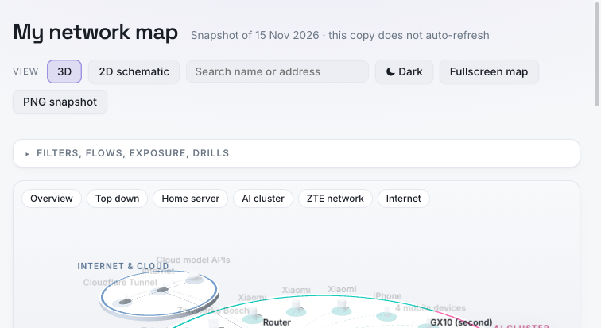

# netglass

A self-hosted, zero-dependency map of your home network. One Python file, one static page, no database, no cloud.

It pings your LAN, watches TCP services, Tailscale peers and anything you point it at, and draws the whole topology as an interactive 3D scene (with a 2D fallback), with live status, latency on every link, availability history, outage timeline and a time-travel view.



## Highlights

- **Live 3D topology** (Three.js, bundled locally) with a 2D SVG schematic fallback; draggable, zoomable, clickable.
- **Per-device glass details** (iOS-style bubble): status, IPs, MAC, vendor, mDNS name, latency, last seen, 24 h availability strip, last outage, Wake-on-LAN.
- **Latency on every link**, incl. Tailscale relay detection (direct vs DERP).
- **Availability history**: per-device 24 h bars, 7-day uptime %, outage list; stored in an append-only JSONL, pruned to N days.
- **Time travel**: inspect the recorded state from 1-168 h ago.
- **Failure drill**: click devices to switch them off and see what loses reachability.
- **Flows & exposure views**: trace a path (Telegram -> bot -> LLM, print job, ...) or highlight what is reachable from the internet / only via tailnet / phones etc.
- **Alerts**: macOS notifications and/or Telegram and/or generic webhook when a device or service goes down, comes back, or an unknown device joins the LAN.
- **PNG snapshot** of the 3D view, **CSV export** of the inventory, **SSE** push updates, **PWA manifest** for installable mobile use.
- **Privacy**: server binds to 127.0.0.1; expose it via Tailscale Serve, an SSH tunnel or your own reverse proxy. No telemetry, nothing leaves your network.

## Requirements

- Python 3.9+ (stdlib only), on macOS, Linux or Windows
- discovery uses `ping` plus: `arp`/`ip neigh` (macOS/Linux), `arp -a` (Windows)
- desktop notifications: osascript (macOS), notify-send (Linux), balloon tip via PowerShell (Windows); or Telegram/webhook anywhere
- optional: `tailscale` binary, Home Assistant device registry, Moonraker, avahi-resolve (Linux mDNS), nmap's `nmap-mac-prefixes` for vendor lookup

CI runs the parser and config test suite on Ubuntu, Windows and macOS (Python 3.9/3.12) via GitHub Actions.

## Quick start

```bash
git clone https://github.com/redmixx/netglass.git && cd netglass
cp config.example.json config.json   # then edit: at minimum lan_cidrs
python3 server.py                    # serves http://127.0.0.1:8790
```

Open the printed URL. The bundled example topology (web/index.html) shows a sample network: edit the `N` (nodes), `L` (links), `NETS`, `SVC` blocks at the top of the file to describe yours - ids there must match `device_ids` / service ids in `config.json`.

### Keep it running

macOS, user agent (`~/Library/LaunchAgents/pl.netglass.netglass.plist`):

```xml
<?xml version="1.0" encoding="UTF-8"?><!DOCTYPE plist PUBLIC "-//Apple//DTD PLIST 1.0//EN"
 "http://www.apple.com/DTDs/PropertyList-1.0.dtd">
<plist version="1.0"><dict>
  <key>Label</key><string>pl.netglass.netglass</string>
  <key>ProgramArguments</key><array><string>/usr/bin/python3</string><string>/opt/netglass/server.py</string></array>
  <key>WorkingDirectory</key><string>/opt/netglass</string>
  <key>KeepAlive</key><true/><key>RunAtLoad</key><true/>
  <key>StandardOutPath</key><string>/tmp/netglass.log</string>
</dict></plist>
```

`launchctl load ~/Library/LaunchAgents/pl.netglass.netglass.plist`

Linux: `ExecStart=/usr/bin/python3 /opt/netglass/server.py` in a user unit, `Restart=always`.

Windows: run `python server.py` at logon via Task Scheduler:

```powershell
schtasks /create /tn netglass /tr "python C:\netglass\server.py" /sc onlogon /ru $env:USERNAME
```

### Exposing it safely

```bash
tailscale serve --bg https / 8790     # tailnet-only, recommended
# or: ssh -L 8790:127.0.0.1:8790 host  # or any local reverse proxy
```

## Configuration

Everything lives in `config.json` (see the documented `config.example.json`):

| key | meaning |
|---|---|
| `port`, `interval_s`, `history_days`, `alert_after_s` | server basics |
| `lan_cidrs` | ranges scanned by ping + ARP (the only required change) |
| `ping_targets` | `{"device_id": "ip"}` extra ICMP probes, reuse ids to feed link RTTs |
| `device_ids`, `labels`, `smoothed_devices` | which ids exist, display names, lag-tolerant (sleepy Wi-Fi) devices |
| `known_macs` | optional static MAC -> id map; runtime assignments land in `assignments.json` |
| `tcp_services` | `{"id","host","port"}` service checks (also drawn as nodes) |
| `link_rtts` | `{"key":"a\|b","device":"x"}` attach a device's RTT to a link drawn in the UI |
| `tailscale_ips` | `{"100.x.y.z": "device_id"}` peers tracked via `tailscale ping` |
| `ha_device_registry`, `moonraker`, `roce_ssh_host` | optional integrations (HA names, 3D printer status, RoCE probes) |
| `alerting` | `macos_notifications`, `telegram_token`+`telegram_chat`, `webhook` |

## HTTP API

`GET /status.json` live snapshot - `GET /history.json` availability aggregates - `GET /at?h=24` recorded state - `GET /export.csv` inventory - `GET /stream` SSE refresh events - `POST /notes`, `/assign`, `/wol`.

## Files (next to the config)

`status.json` latest snapshot, `history.jsonl` append-only samples, `state.json` collector memory, `notes.json` / `assignments.json` edited from the UI.

## License

MIT, see [LICENSE](LICENSE).
